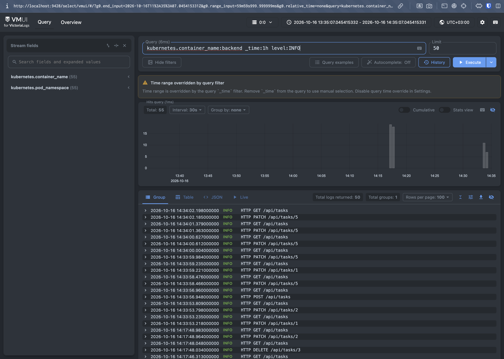
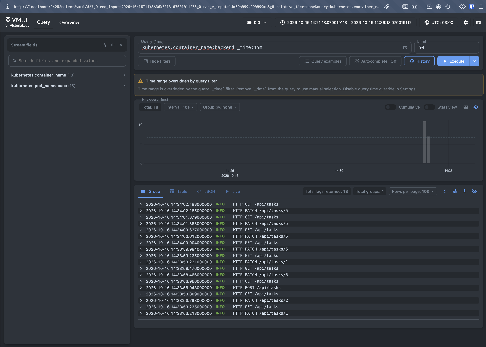
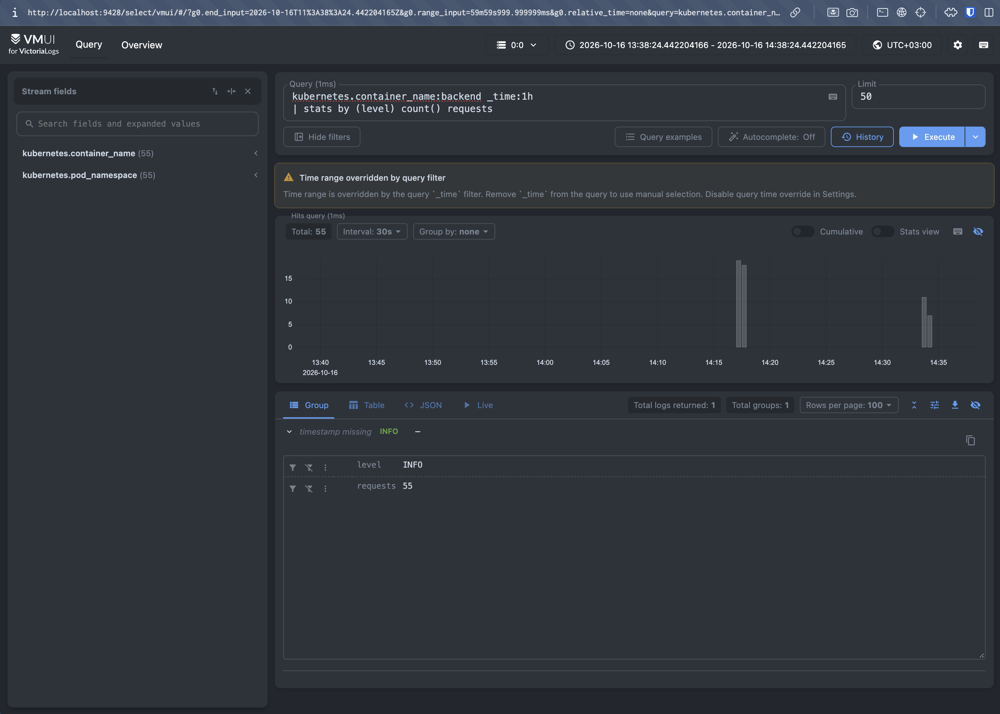
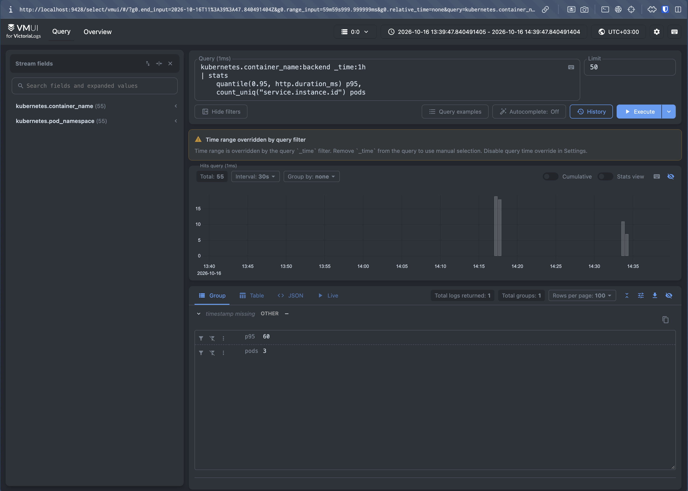

# Отчёт по Victoria Logs

## Метод развёртывания Victoria Logs

Я поднимал, используя helm charts. Helm values находятся в `k8s/logging/vector-values.yaml` и `k8s/logging/victoria-logs-values.yaml`.

## Метод доставки и обоснование

Для Vector я выбрал DaemonSet, читающий /var/log/containers, так как в таком случае будет один сборщик на много подов внутри ноды. Это экономнее по ресурсам, чем сборщик для каждого пода в случае с сайдкар. Также при DaemonSet проще дополнять записи методанными кубера (имя пода, namespace и тд), так как он на уровне ноды.

## Запросы

1. `kubernetes.container_name:backend _time:15m` - получить сырые логи контейнера backend за последние 15 минут



2. `kubernetes.container_name:backend _time:1h level:INFO` - получить логи контейнера backend только уровня INFO



3. `kubernetes.container_name:backend _time:1h | stats by (level) count() requests` - посчитать число логов по каждому level



4. `kubernetes.container_name:backend _time:1h | stats quantile(0.95, http.duration_ms) p95, count_uniq("service.instance.id") pods` - получить 95-й перцентиль http.duration_ms и count_uniq() - сколько уникальных подов писали логи




# Отчёт по k8s

## Использованные абстракции Kubernetes

| Абстракция | Назначение в проекте |
|---|---|
| **Deployment** | Запуск stateless-сервисов: `task-manager-backend` (3 реплики) и `task-manager-frontend` (1 реплика) |
| **StatefulSet** | Запуск PostgreSQL с стабильным именем пода и постоянным хранилищем |
| **Service** | Сетевой доступ к подам: ClusterIP для frontend/backend, headless для postgres |
| **Ingress** | Внешний HTTP-вход на хост `app.test` с маршрутизацией по путям |
| **Secret** | Хранение учётных данных, что раньше было в env (`task-manager-secret`) |
| **PersistentVolumeClaim** | Диск для данных PostgreSQL через `volumeClaimTemplates` |

## Взаимодействие сервисов

```
Клиент (браузер)
        │
        v
   Ingress (app.test)
        │
        ├── /         -> Service frontend:3000 → Pod nginx (статика UI)
        │
        └── /api      -> Service backend:8080  → Pods Spring Boot (API)
                                │
                                v
                    Service postgres:5432 (headless)
                                │
                                v
                          StatefulSet PostgreSQL
```

1. **Клиент -> Ingress.** Запросы к `app.test` принимает Ingress-контроллер nginx.
2. **Ingress -> Frontend / Backend.** Путь `/` идёт на `task-manager-frontend`, префикс `/api` — на `task-manager-backend`.
3. **Frontend -> Backend.** UI обращается к API по относительному URL `/api`. Запросы снова проходят через Ingress к backend.
4. **Backend -> PostgreSQL.** Backend подключается по DNS-имени `task-manager-postgres:5432` из Secret. Учётные данные тоже берутся из Secret.

## Доступ к UI
В ```/etc/hosts``` надо прописать ```127.0.0.1 app.test```, чтобы заголовк Host был app.test. Эту нужно так как в манифесте праивло завязано на хост. Также необходимо прокинуть порт ```kubectl port-forward -n ingress-nginx svc/ingress-nginx-controller 8090:80```. В итога доступ в браузере будет по url: ```http://app.test:8090/```