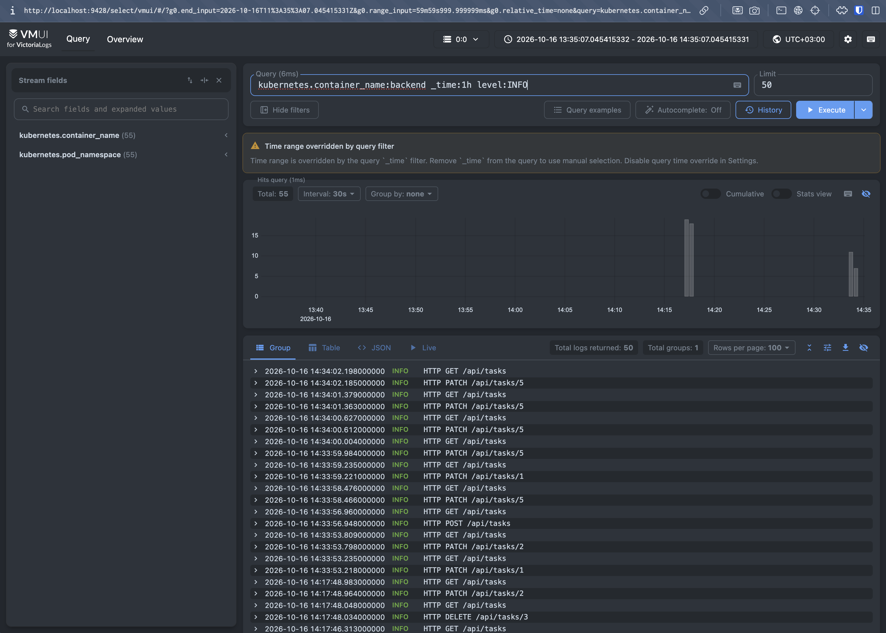
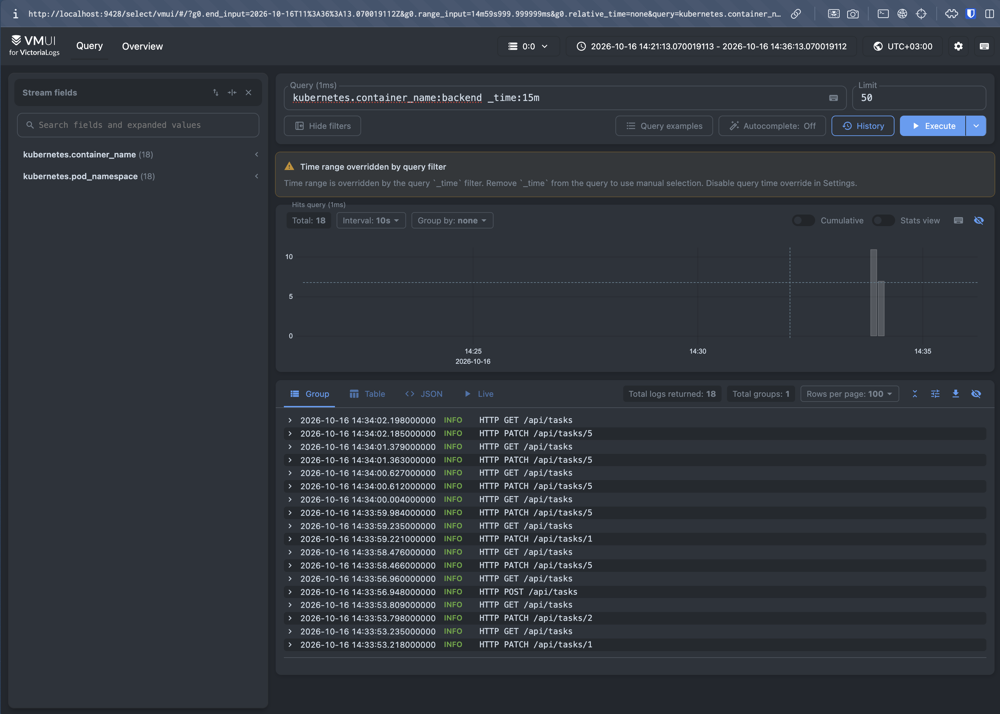
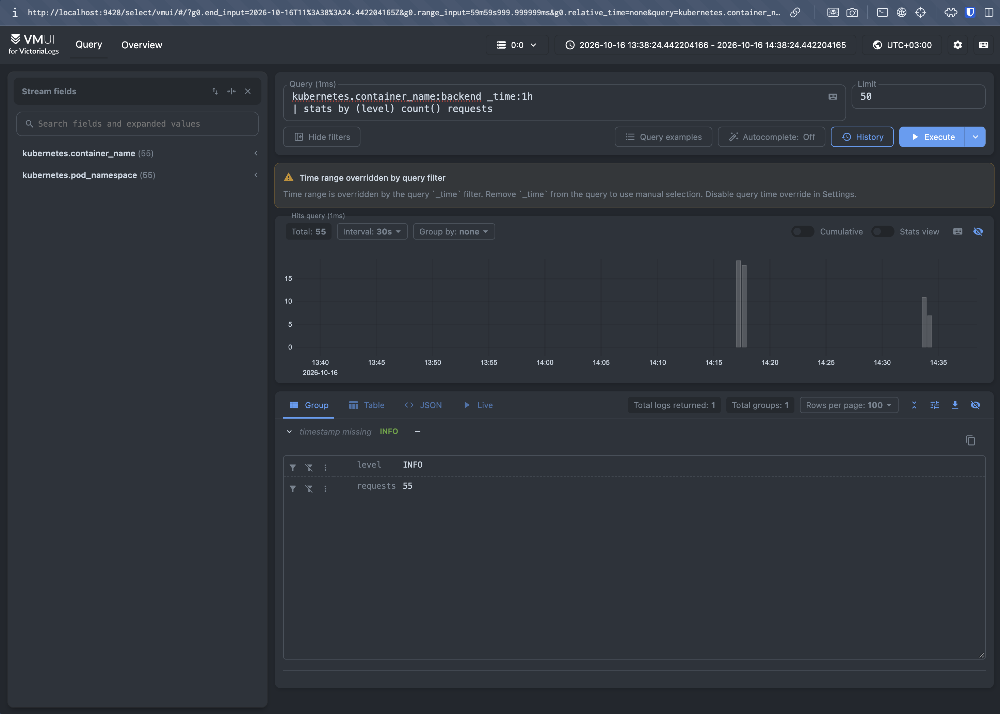
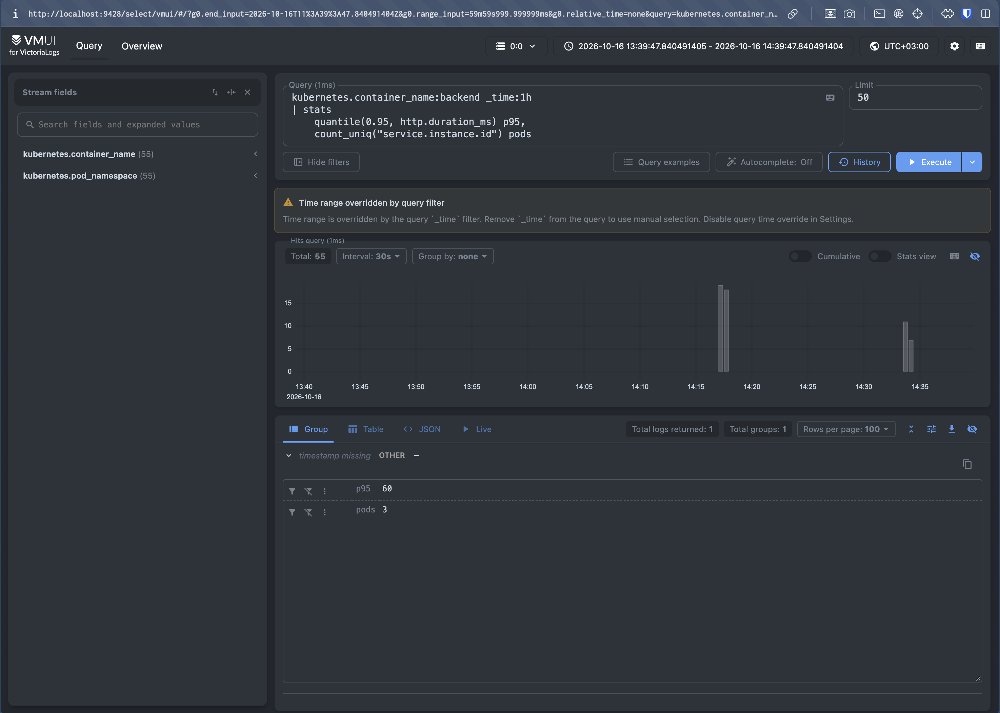

# Отчёт по SLI / SLO / SLA

## Выбранные метрики (из прошлого ДЗ)

| Метрика | Источник | Роль |
|---|---|---|
| `http_server_requests_seconds_count` | Spring Actuator / Micrometer | Успешность HTTP (RBSLO) |
| `taskmanager_auth_logins_total` | бизнес-метрика | Успешные логины (RBSLO) |
| `taskmanager_auth_failed_logins_total` | бизнес-метрика | Неуспешные логины (RBSLO) |
| `pg_up` | postgres-exporter | Доступность БД (TBSLO) |

Полный список PromQL: [`k8s/metrics/sli-queries.md`](k8s/metrics/sli-queries.md).

## SLI

### SLI-1 — HTTP availability (Request Based)

Доля HTTP-запросов без 5xx:

$$
SLI_{http} = \frac{\sum good\_requests}{\sum all\_requests}
$$

```promql
sum(rate(http_server_requests_seconds_count{namespace="application",status!~"5.."}[5m]))
/
sum(rate(http_server_requests_seconds_count{namespace="application"}[5m]))
```

### SLI-2 — Auth success (Request Based)

Доля успешных логинов среди всех попыток входа:

$$
SLI_{auth} = \frac{logins}{logins + failed\_logins}
$$

```promql
sum(rate(taskmanager_auth_logins_total[5m]))
/
(
  sum(rate(taskmanager_auth_logins_total[5m]))
  +
  sum(rate(taskmanager_auth_failed_logins_total[5m]))
)
```

### SLI-3 — Postgres availability (Time Based)

Доля времени, когда Postgres доступен (`pg_up == 1`):

$$
SLI_{db} = \frac{хорошие\_минуты}{все\_минуты}
$$

```promql
avg_over_time(pg_up{namespace="application"}[15m])
```

(для «прод»-окна можно заменить `[15m]` на `[1h]` / `[30d]`).

## SLO

| SLO | Условие | Error budget |
|---|---|---|
| SLO-1 HTTP | \( SLI_{http} \ge 0.99 \) | 1% |
| SLO-2 Auth | \( SLI_{auth} \ge 0.95 \) | 5% |
| SLO-3 DB | \( SLI_{db} \ge 0.999 \) | 0.1% |

Пример индикатора нарушения SLO-1 (1 = breach):

```promql
(
  sum(rate(http_server_requests_seconds_count{namespace="application",status!~"5.."}[5m]))
  /
  sum(rate(http_server_requests_seconds_count{namespace="application"}[5m]))
) < bool 0.99
```

## SLA

**SLA приложения:**

1. Доступность HTTP API ≥ 99% (доля не-5xx запросов).
2. Успешность аутентификации ≥ 95% среди попыток login.
3. Доступность PostgreSQL ≥ 99.9% по времени.

**Общий SLA:** все три SLO выполняются одновременно. Score 0..1:

```promql
(
  ((
    sum(rate(http_server_requests_seconds_count{namespace="application",status!~"5.."}[5m]))
    /
    sum(rate(http_server_requests_seconds_count{namespace="application"}[5m]))
  ) >= bool 0.99)
  +
  ((
    sum(rate(taskmanager_auth_logins_total[5m]))
    /
    (
      sum(rate(taskmanager_auth_logins_total[5m]))
      +
      sum(rate(taskmanager_auth_failed_logins_total[5m]))
    )
  ) >= bool 0.95)
  +
  (
    max(avg_over_time(pg_up{namespace="application"}[15m])) >= bool 0.999
  )
) / 3
```

Значение `1` — все SLO зелёные; `< 1` — хотя бы один нарушен.


## Изменения приложения для демонстрации

1. **Демо-флаг `APP_DEMO_FAIL_RATE`** (`DemoFailFilter`): эта переменная среда задёт, что с вероятностью N backend отвечает `500` на `/api/**`, чтобы в `http_server_requests_*` появились 5xx и упал `SLI_http`. По умолчанию `0` (выключен).
2. **Скрипт нагрузки** [`scripts/sli-demo.sh`](scripts/sli-demo.sh): успешные/неуспешные логины и запросы к задачам.

### **Скрипт нагрузки**

Режим задаётся первым аргументом: `./scripts/sli-demo.sh <mode>`. По умолчанию — `mixed`. Число итераций — `ROUNDS` (по умолчанию 30).

| Режим | Что делает | Зачем в демо |
|---|---|---|
| **`success`** | Только успешные `login` | Поднять `SLI_auth` |
| **`fail`** | Только логины с неверным паролем | Уронить `SLI_auth` |
| **`tasks`** | Логин → N раз `GET /api/tasks` + `POST /api/tasks` | Нагрузка на HTTP; вместе с `APP_DEMO_FAIL_RATE` — 5xx и падение `SLI_http` |
| **`mixed`** (default) | ~2/3 успешных логинов, ~1/3 fail + `list tasks` | Смешанный фон метрик |

Примеры:
```bash
./scripts/sli-demo.sh success
ROUNDS=20 ./scripts/sli-demo.sh fail
BASE_URL=http://app.test:8090 ./scripts/sli-demo.sh tasks
```

Включение fail-injection на время демо:

```bash
kubectl -n application set env deployment/task-manager-backend APP_DEMO_FAIL_RATE=0.5
kubectl -n application rollout status deployment/task-manager-backend
# выключение
kubectl -n application set env deployment/task-manager-backend APP_DEMO_FAIL_RATE=0
kubectl -n application rollout status deployment/task-manager-backend


# проверить внутри подов:
kubectl -n application get pods -l app=task-manager-backend \
  -o jsonpath='{range .items[*]}{.metadata.name}{" "}{.spec.containers[0].env[?(@.name=="APP_DEMO_FAIL_RATE")].value}{"\n"}{end}'
```

# Отчёт по метрикам (Victoria Metrics)

## Развёртывание Victoria Metrics

Victoria Metrics Single установлена через Helm-чарт `vm/victoria-metrics-single` в namespace `metrics`. Values: `k8s/metrics/guide-vmsingle-values.yaml`.

В scrape-конфиг добавлен job `kubernetes-pods` с service discovery по аннотациям `prometheus.io/*`.

## Runtime-метрики backend

Стек: Spring Boot Actuator + Micrometer Prometheus registry.

- Зависимость: `micrometer-registry-prometheus`
- Endpoint: `/actuator/prometheus` (порт 8080)
- Аннотации на Deployment backend:
  - `prometheus.io/scrape: "true"`
  - `prometheus.io/port: "8080"`
  - `prometheus.io/path: "/actuator/prometheus"`

Из коробки доступны JVM/HTTP-метрики (`jvm_*`, `http_server_requests_*`, `process_*` и т.д.).

## Бизнес-метрики

| Prometheus-имя | Смысл |
|---|---|
| `taskmanager_auth_logins_total` | Успешные логины |
| `taskmanager_auth_registrations_total` | Успешные регистрации |
| `taskmanager_auth_failed_logins_total` | Неудачные попытки входа |
| `taskmanager_tasks_created_total` | Созданные задачи |
| `taskmanager_tasks_completed_total` | Переходы статуса задачи в `DONE` |

Реализация: класс `AppMetrics` + инкременты в `AuthService` / `TaskService`.

## Метрики PostgreSQL

В StatefulSet `postgres` добавлен sidecar-контейнер `prometheuscommunity/postgres-exporter` на порту `9187` (общий network namespace с Postgres → подключение к `localhost:5432`).

Аннотации на pod template:

- `prometheus.io/scrape: "true"`
- `prometheus.io/port: "9187"`
- `prometheus.io/path: "/metrics"`

Примеры метрик: `pg_up`, `pg_stat_database_*`, `pg_settings_*`.

## Проверка сбора

```bash
kubectl -n metrics port-forward svc/vmsingle-victoria-metrics-single-server 8428:8428
```

- Targets: http://127.0.0.1:8428/targets
- Примеры запросов в UI `/vmui` или через API:
  - `taskmanager_tasks_created_total`
  - `jvm_memory_used_bytes{namespace="application"}`
  - `pg_up{namespace="application"}`


# Отчёт по Victoria Logs

## Метод развёртывания Victoria Logs

Я поднимал, используя helm charts. Helm values находятся в `k8s/logging/vector-values.yaml` и `k8s/logging/victoria-logs-values.yaml`.

## Метод доставки и обоснование

Для Vector я выбрал DaemonSet, читающий /var/log/containers, так как в таком случае будет один сборщик на много подов внутри ноды. Это экономнее по ресурсам, чем сборщик для каждого пода в случае с сайдкар. Также при DaemonSet проще дополнять записи методанными кубера (имя пода, namespace и тд), так как он на уровне ноды.

## Запросы

1. `kubernetes.container_name:backend _time:15m` - получить сырые логи контейнера backend за последние 15 минут



2. `kubernetes.container_name:backend _time:1h level:INFO` - получить логи контейнера backend только уровня INFO



3. `kubernetes.container_name:backend _time:1h | stats by (level) count() requests` - посчитать число логов по каждому level



4. `kubernetes.container_name:backend _time:1h | stats quantile(0.95, http.duration_ms) p95, count_uniq("service.instance.id") pods` - получить 95-й перцентиль http.duration_ms и count_uniq() - сколько уникальных подов писали логи




# Отчёт по k8s

## Использованные абстракции Kubernetes

| Абстракция | Назначение в проекте |
|---|---|
| **Namespace** | Изоляция приложения в `application`; логи - `logging`; метрики - `metrics` |
| **Deployment** | Запуск stateless-сервисов: `task-manager-backend` (3 реплики) и `task-manager-frontend` (1 реплика) |
| **StatefulSet** | Запуск PostgreSQL с стабильным именем пода и постоянным хранилищем; sidecar `postgres-exporter` |
| **Service** | Сетевой доступ к подам: ClusterIP для frontend/backend, headless для postgres |
| **Ingress** | Внешний HTTP-вход на хост `app.test` с маршрутизацией по путям |
| **Secret** | Хранение учётных данных (`task-manager-secret`) |
| **PersistentVolumeClaim** | Диск для данных PostgreSQL через `volumeClaimTemplates` |

## Взаимодействие сервисов

```
Клиент (браузер)
        │
        v
   Ingress (app.test)  [ns: application]
        │
        ├── /         -> Service frontend:3000 → Pod nginx (статика UI)
        │
        └── /api      -> Service backend:8080  → Pods Spring Boot (API)
                                │
                                v
                    Service postgres:5432 (headless)
                                │
                                v
                          StatefulSet PostgreSQL
                          (+ postgres-exporter :9187)
```

1. **Клиент -> Ingress.** Запросы к `app.test` принимает Ingress-контроллер nginx.
2. **Ingress -> Frontend / Backend.** Путь `/` идёт на `task-manager-frontend`, префикс `/api` - на `task-manager-backend`.
3. **Frontend -> Backend.** UI обращается к API по относительному URL `/api`. Запросы снова проходят через Ingress к backend.
4. **Backend -> PostgreSQL.** Backend подключается по DNS-имени `task-manager-postgres:5432` из Secret. Учётные данные тоже берутся из Secret.

## Доступ к UI
В `/etc/hosts` надо прописать `127.0.0.1 app.test`, чтобы заголовок Host был app.test. Это нужно так как в манифесте правило завязано на хост. Также необходимо прокинуть порт `kubectl port-forward -n ingress-nginx svc/ingress-nginx-controller 8090:80`. В итоге доступ в браузере будет по url: `http://app.test:8090/`.


# Инструкция: поднять всё с нуля

Команды выполнять из корня репозитория.

## 0. Предусловия на машине

- Установлены: `minikube`, `kubectl`, `helm`, `docker`
- В `/etc/hosts` есть строка: `127.0.0.1 app.test`

## 1. Кластер Minikube

```bash
minikube start
minikube addons enable ingress
```

Проверка ingress-контроллера:

```bash
kubectl -n ingress-nginx get pods
# дождаться Running у ingress-nginx-controller
```

## 2. Сборка образов и загрузка в Minikube

У backend и frontend стоит `imagePullPolicy: Never` — Kubernetes **не** качает их из registry.
Образы нужно сначала собрать на хосте, затем **явно загрузить** в Minikube (иначе будет `ErrImageNeverPull`).

Из корня репозитория:

```bash
# 1) Сборка в локальном Docker (OrbStack / Docker Desktop)
docker build -t task-manager-backend:latest ./backend
docker build -t task-manager-frontend:latest ./frontend

# 2) Загрузка образов внутрь Minikube
minikube image load task-manager-backend:latest
minikube image load task-manager-frontend:latest

# 3) Проверка, что образы видны Minikube
minikube image ls | grep task-manager
```

Ожидаются строки с `task-manager-backend:latest` и `task-manager-frontend:latest`.

Если поды уже созданы и висят в `ErrImageNeverPull` — после `image load` пересоздать их:

```bash
kubectl -n application rollout restart deployment/task-manager-backend
kubectl -n application rollout restart deployment/task-manager-frontend
```

## 3. Namespace’ы

```bash
kubectl apply -f k8s/namespaces/application.yaml
kubectl create namespace logging --dry-run=client -o yaml | kubectl apply -f -
kubectl create namespace metrics --dry-run=client -o yaml | kubectl apply -f -
```

## 4. Секрет и приложение (ns `application`)

```bash
kubectl apply -f k8s/secrets/task-manager-secret.yaml

kubectl apply -f k8s/services/postgres-service.yaml
kubectl apply -f k8s/statefulsets/task-manager-statefulset.yaml

kubectl apply -f k8s/services/backend-service.yaml
kubectl apply -f k8s/services/frontend-service.yaml
kubectl apply -f k8s/deployments/backend-deploymet.yaml
kubectl apply -f k8s/deployments/frontend-deplopyment.yaml

kubectl apply -f k8s/ingress/ingress.yaml
```

Дождаться готовности:

```bash
kubectl -n application get pods
# postgres-0: 2/2 Ready (postgres + exporter)
# backend / frontend: Running + Ready
```

## 5. Доступ к UI

В отдельном терминале:

```bash
kubectl port-forward -n ingress-nginx svc/ingress-nginx-controller 8090:80
```

Открыть: http://app.test:8090/

## 6. Логи: Victoria Logs + Vector (ns `logging`)

```bash
helm repo add victoria-metrics https://victoriametrics.github.io/helm-charts/
helm repo add vector https://helm.vector.dev
helm repo update

helm upgrade --install vlogs victoria-metrics/victoria-logs-single \
  -n logging \
  -f k8s/logging/victoria-logs-values.yaml

helm upgrade --install vector vector/vector \
  -n logging \
  -f k8s/logging/vector-values.yaml
```

Проверка логов:

```bash
kubectl -n logging port-forward svc/vlogs-victoria-logs-single-server 9428:9428
# http://127.0.0.1:9428
```

## 7. Метрики: Victoria Metrics Single (ns `metrics`)

По инструкции (шаги 1–2, без Grafana):

```bash
helm repo add vm https://victoriametrics.github.io/helm-charts/
helm repo update

helm upgrade --install vmsingle vm/victoria-metrics-single \
  -n metrics \
  -f k8s/metrics/guide-vmsingle-values.yaml
```

Проверка:

```bash
kubectl -n metrics get pods
kubectl -n metrics port-forward svc/vmsingle-victoria-metrics-single-server 8428:8428
```

- Targets: http://127.0.0.1:8428/targets - должны быть backend-поды и postgres (exporter)
- Метрики: http://127.0.0.1:8428/vmui

## 8. Быстрая проверка бизнес-метрик

1. Зарегистрироваться / залогиниться через UI, создать задачу, перевести в `DONE`, сделать неверный логин.
2. В VMUI выполнить, например: `taskmanager_auth_logins_total`, `taskmanager_tasks_created_total`, `pg_up`.

## 9. Пересборка образов после правок кода

После любых изменений кода снова собрать образ, загрузить в Minikube и перезапустить Deployment:

```bash
docker build -t task-manager-backend:latest ./backend
minikube image load task-manager-backend:latest
kubectl -n application rollout restart deployment/task-manager-backend
```

Для frontend:

```bash
docker build -t task-manager-frontend:latest ./frontend
minikube image load task-manager-frontend:latest
kubectl -n application rollout restart deployment/task-manager-frontend
```
